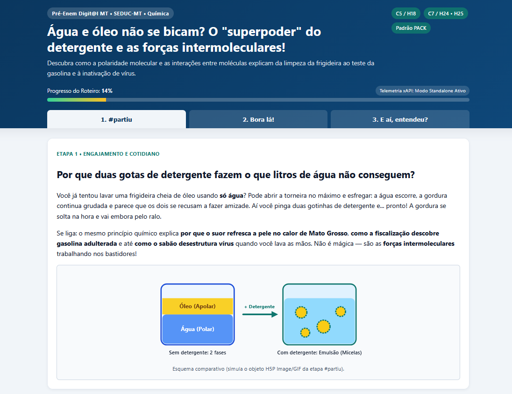

# PACK Interativo — Água, óleo e o "superpoder" do detergente: Forças Intermoleculares

Roteiro de Aprendizagem Interativo desenvolvido no padrão **PACK – Visão do Estudante (Plurall)** para o **Projeto Pré-Enem Digit@l MT (SEDUC-MT)** — Atividades Pós-ENEM 2026 (preparação para o ENEM 2027).

## 1. Dados Pedagógicos
- **Área do Conhecimento:** Ciências da Natureza e suas Tecnologias
- **Componente Curricular:** Química
- **Tema Recorrente no ENEM:** Polaridade Molecular, Forças Intermoleculares, Solubilidade e Ação de Tensoativos (Sabões e Detergentes)
- **Competências e Habilidades (Matriz ENEM):** C5/H18, C7/H24 e C7/H25

## 2. Arquitetura Técnica
- **HTML5 Semântico:** `<header>`, `<nav role="tablist">`, `<main>`, `<section role="tabpanel">` e atributos ARIA (WCAG AA).
- **CSS3 Responsivo:** Design System PACK baseado em variáveis CSS (`:root`), layout mobile-first com Flexbox/Grid e SVG inline (zero dependência de imagens externas quebradas).
- **JavaScript (ES6+):** Navegação sem recarregamento, barra de progresso dinâmica, acordeão de hipóteses, carrossel de microlearning (1/6 a 6/6), explorador de *hotspots* da micela, motor de quiz padrão ENEM (A–E) com feedback por distrator e integração xAPI (`H5P.externalDispatcher`).

## 3. Como Publicar no GitHub Pages
1. Crie um repositório público no GitHub (ex.: `pack-forcas-intermoleculares-mt`).
2. Faça upload dos arquivos mantendo a estrutura de pastas (`index.html`, `css/styles.css`, `js/app.js`, `docs/` e `README.md`).
3. Acesse **Settings → Pages**.
4. Em **Build and deployment → Source**, selecione **Deploy from a branch**.
5. Escolha a branch `main` e a pasta `/ (root)`, depois clique em **Save**.
6. Em poucos minutos, o roteiro estará acessível via `https://<seu-usuario>.github.io/pack-forcas-intermoleculares-mt/`.

## 4. Integração com H5P / Moodle / Plurall
O arquivo `js/app.js` detecta automaticamente a presença do objeto global `window.H5P.externalDispatcher` para emitir eventos xAPI (`experienced`, `interacted`, `answered`, `completed`). Em hospedagem estática (GitHub Pages), opera em modo standalone registrando o log em `window.PACK_XAPI_LOG`.

## 5. Documentação Complementar
- [Relatório de Uso Responsável de IA](docs/RELATORIO_USO_IA.md)
- [Plano de Sprints (Pós-ENEM 2026)](docs/PLANO_DE_SPRINTS.md)

  
  
  

